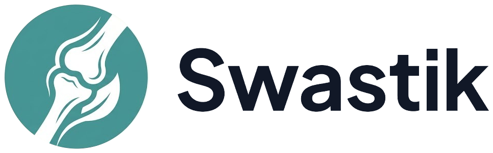

  
  <h1>Swastik: Joint & Bone Health Initiative 🦴</h1>
  
<strong>Empowering Remote Dispensaries & Providing AI-Driven Patient Care</strong>

---

## 💡 Inspiration
In rural and underserved regions (such as North East India), fully qualified orthopedic specialists are incredibly scarce. Initial care and diagnosis often fall upon local dispensary technicians who lack formal specialized training in joint conditions. Meanwhile, elderly patients suffer from debilitating Osteoarthritis and Osteoporosis, often struggling with complex modern health apps to track their pain. **Swastik** was born to solve both sides of this healthcare gap.

---

## ✨ Core Features

### 1. 🎓 Remote Technician Education & Certification
Swastik serves as an evidence-based medical education hub for local technicians.
* **Targeted Curriculum:** Easy-to-understand, interactive modules covering the symptoms, progression, and basic care strategies for Osteoarthritis and Osteoporosis.
* **Proctored Mastery Exam:** Technicians undergo a strict, anti-cheat assessment to test their clinical understanding.
* **Cryptographic Certification:** Upon passing, technicians are awarded an official **Certificate of Clinical Mastery**. 
  * *The certificate is generated with premium national-crest aesthetics and features an interactive **Blockchain Proof** drawer that verifies the technician's active study time and exam integrity (e.g., tracking tab switches).*

### 2. 🏥 AI-Powered Patient Dashboard
A highly accessible, personalized health dashboard designed specifically for the elderly and those with limited mobility.
* **Tri-Layer Voice Assistant Form:** Recognizing that elderly patients may struggle with typing, the dashboard features a voice-first pain journal. Patients speak naturally (in multiple languages), and our AI automatically extracts pain levels, symptoms, and updates the journal.
* **Longitudinal Pain History:** A visual graphed history of pain trends, making it incredibly easy to present progress to a doctor.
* **AI Health Insights:** Leverages Google Gemini to continuously analyze historical pain entries, providing encouraging, personalized insights and identifying symptom triggers.
* **Media Uploads:** Patients can attach audio notes or pictures of localized swelling directly to their logs.
* **Multi-Lingual RAG Chatbot:** A personalized AI assistant that is aware of the patient's medical journal history. It answers general joint health questions while referencing specific past symptoms with empathy.

---

## 🛠️ How We Built It (Tech Stack)
* **Frontend:** Next.js 14, React, Tailwind CSS, Framer Motion (for smooth, accessible micro-animations).
* **Backend:** Next.js API Routes, Prisma ORM, PostgreSQL (via DigitalOcean).
* **AI Integration:** Google Gemini API (for advanced symptom extraction, Voice-to-JSON parsing, and personalized RAG health insights).
* **Voice / TTS:** Native Web Speech API & MediaRecorder API.
* **UI Components:** Lucide Icons, Recharts (for medical data visualization).

---

## 🚧 Challenges We Ran Into
* **Designing for the Elderly:** Building a UI that wasn't overwhelming was incredibly difficult. We had to rethink standard forms and replace them with a robust, multi-lingual Voice AI that correctly maps unstructured spoken words into structured medical JSON data.
* **Context-Aware AI:** Integrating Google Gemini so that the chatbot didn't just give generic medical advice, but actually read the patient's past journal entries and responded with personalized empathy.

---

## 🚀 What's Next for Swastik
* **Tiger Data Integration:** Migrating our longitudinal medical records to a high-performance time-series database for predictive analytics.
* **WhatsApp Integration:** Allowing patients to log their daily pain scores simply by sending a voice note to a WhatsApp bot.
* **Solana NFT Badges:** Issuing verifiable, non-transferable NFTs for technicians who complete advanced clinical certifications.

  <i>Dedicated to making specialized healthcare knowledge accessible to everyone, everywhere.</i>

